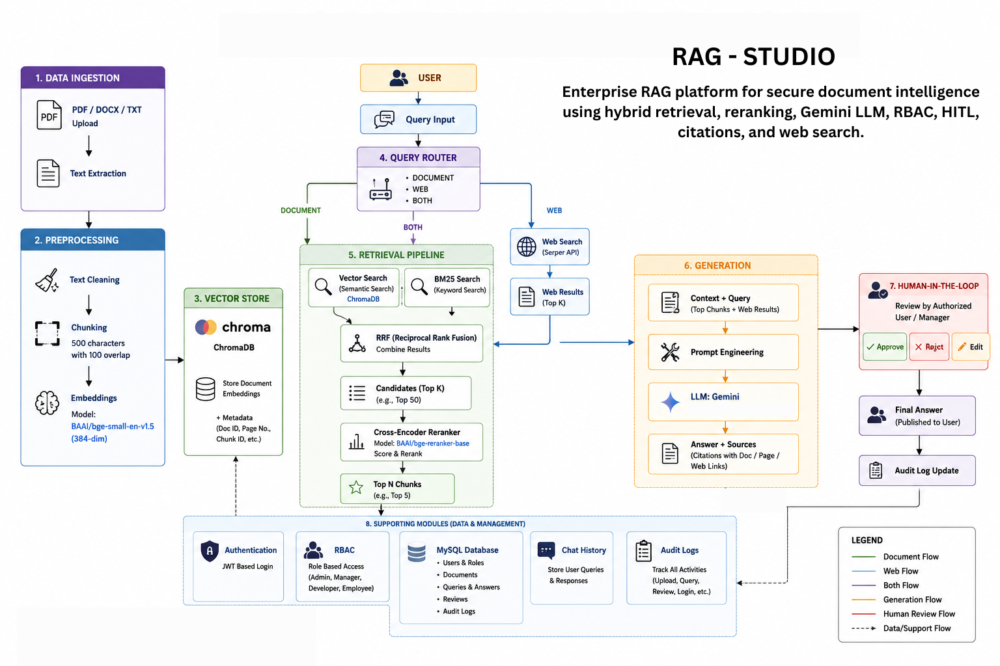

# RAG Studio
[](https://www.python.org/)
[](https://flask.palletsprojects.com/)
[](https://www.langchain.com/)
[](https://www.trychroma.com/)
[](https://www.docker.com/)
[](LICENSE)
### Enterprise RAG Platform for Secure Document Intelligence

**RAG Studio** is an enterprise-focused Retrieval-Augmented Generation (RAG) platform for document-based question answering.

The platform allows users to securely upload and manage enterprise documents, retrieve relevant information using hybrid search, generate grounded responses using Gemini LLM, and view source citations for better transparency.

It combines **semantic vector search, BM25 keyword search, Reciprocal Rank Fusion (RRF), Cross-Encoder reranking, query routing, web search, RBAC, Human-in-the-Loop review, audit logging, chat history, and analytics** into a single Flask-based application.

---

## 🚀 Key Features

* 🔐 **Authentication & Role-Based Access Control (RBAC)**
* 📄 **PDF, DOCX and TXT document ingestion**
* ✂️ **Configurable text chunking**
* 🧠 **BGE-based vector embeddings**
* 🔎 **Semantic vector search using ChromaDB**
* 🔤 **BM25 keyword search**
* 🔀 **Hybrid retrieval using Reciprocal Rank Fusion (RRF)**
* 🎯 **Cross-Encoder reranking**
* 🤖 **Gemini LLM-based answer generation**
* 🧭 **Intelligent query routing**
* 🌐 **Tavily web search for external information**
* 📚 **Internal document + web search combination**
* 🔗 **Source citations**
* 💬 **Chat history and searchable conversations**
* 👨‍💼 **Human-in-the-Loop (HITL) answer review**
* 📝 **Human approval, rejection and editing of AI responses**
* 📊 **Query and response-time analytics**
* 🛡️ **Audit logging**
* 🐳 **Docker & Docker Compose deployment**
* 🧪 **Automated pytest test suite**

---

# 🏗️ System Architecture

## 🏗️ System Architecture



```text
                         ┌─────────────────────┐
                         │       User          │
                         └──────────┬──────────┘
                                    │
                                    ▼
                         ┌─────────────────────┐
                         │ Flask Web Interface │
                         └──────────┬──────────┘
                                    │
                                    ▼
                         ┌─────────────────────┐
                         │    Query Router     │
                         └──────────┬──────────┘
                                    │
                 ┌──────────────────┼──────────────────┐
                 │                  │                  │
                 ▼                  ▼                  ▼
             DOCUMENT              WEB                BOTH
                 │                  │                  │
                 ▼                  ▼                  ▼
        ┌────────────────┐   ┌──────────────┐   ┌──────────────┐
        │ Hybrid Search  │   │ Tavily Search│   │ Both Sources │
        └───────┬────────┘   └──────┬───────┘   └──────┬───────┘
                │                   │                  │
                ▼                   │                  │
        ┌────────────────┐          │                  │
        │ Vector Search  │          │                  │
        │   ChromaDB     │          │                  │
        └───────┬────────┘          │                  │
                │                   │                  │
                ├────────────┐      │                  │
                │            │      │                  │
                ▼            ▼      │                  │
             Vector         BM25   │                  │
             Search        Search   │                  │
                │            │      │                  │
                └─────┬──────┘      │                  │
                      ▼             │                  │
               ┌─────────────┐     │                  │
               │     RRF     │     │                  │
               └──────┬──────┘     │                  │
                      ▼             │                  │
             ┌─────────────────┐   │                  │
             │ Cross-Encoder   │   │                  │
             │    Reranker     │   │                  │
             └────────┬────────┘   │                  │
                      │            │                  │
                      └────────────┼──────────────────┘
                                   ▼
                         ┌─────────────────────┐
                         │ Context Assembly    │
                         └──────────┬──────────┘
                                    │
                                    ▼
                         ┌─────────────────────┐
                         │    Gemini LLM       │
                         └──────────┬──────────┘
                                    │
                                    ▼
                    ┌──────────────────────────────┐
                    │ Grounded Answer + Citations  │
                    └──────────────┬───────────────┘
                                   │
                 ┌─────────────────┼─────────────────┐
                 ▼                 ▼                 ▼
            Chat History       Analytics        HITL Review
```

---

# 📚 RAG Workflow

RAG Studio follows a complete document-to-answer pipeline.

## 1. Document Ingestion

Users can upload:

```text
PDF
DOCX
TXT
```

The system validates the file type and stores document metadata in MySQL.

---

## 2. Text Extraction

The uploaded document is parsed using:

* **PyMuPDF** for PDF documents
* **python-docx** for DOCX documents
* Native text processing for TXT files

---

## 3. Chunking

Extracted text is divided into smaller chunks to improve retrieval.

Current configuration:

```text
Chunk Size   : 500 characters
Overlap      : 100 characters
```

The overlap helps preserve context between adjacent chunks.

---

## 4. Embedding Generation

Each chunk is converted into a numerical vector using:

```text
BAAI/bge-small-en-v1.5
```

These embeddings represent the semantic meaning of the text.

---

## 5. Vector Storage

The generated embeddings and chunk metadata are stored in:

```text
ChromaDB
```

Metadata includes information such as:

* Document ID
* Document title
* Chunk index
* Page number

---

# 🔎 Hybrid Retrieval

Instead of relying only on semantic search, RAG Studio combines two retrieval approaches.

### Semantic Search

Uses:

```text
BGE Embeddings
        ↓
ChromaDB
        ↓
Semantic similarity
```

This helps retrieve content that is semantically similar to the user's question.

### Keyword Search

Uses:

```text
BM25
```

This helps retrieve documents containing important exact terms, keywords, names, or phrases.

### Reciprocal Rank Fusion

The results from vector search and BM25 are combined using **RRF**.

Conceptually:

```text
Vector Search
      +
   BM25 Search
      ↓
      RRF
      ↓
Combined ranking
```

The RRF score is calculated using:

```text
RRF Score = 1 / (k + rank)
```

This allows the system to combine rankings without directly comparing the different retrieval score scales.

---

# 🎯 Cross-Encoder Reranking

After hybrid retrieval, the candidate results are reranked using a Cross-Encoder.

```text
User Query
     +
Retrieved Chunk
     ↓
Cross-Encoder
     ↓
Relevance Score
```

The current reranker is:

```text
cross-encoder/ms-marco-MiniLM-L-6-v2
```

The reranker improves the final ordering of retrieved chunks before they are passed to the LLM.

The RAG pipeline ultimately uses the top relevant chunks as context.

---

# 🧭 Query Routing

RAG Studio supports three query routes:

```text
DOCUMENT
WEB
BOTH
```

### DOCUMENT

Used when the answer should come from uploaded enterprise documents.

```text
Question
   ↓
Hybrid Retrieval
   ↓
Reranking
   ↓
Gemini
```

### WEB

Used when external/current information is required.

```text
Question
   ↓
Tavily Web Search
   ↓
Gemini
```

### BOTH

Combines internal enterprise knowledge with external web information.

```text
Question
     ↓
 ┌───┴────┐
 ↓        ↓
Internal  Web
RAG      Search
 ↓        ↓
 └───┬────┘
     ↓
Combined Context
     ↓
Gemini
```

---

# 🤖 LLM Response Generation

The retrieved information is assembled into a context and passed to the Gemini LLM through LangChain.

The LLM generates an answer based on the retrieved context rather than relying only on its internal knowledge.

The system also records:

* User question
* Generated response
* Response time
* Source document
* Page number
* Web sources
* Query success/failure

---

# 🔗 Source Citations

RAG Studio provides source information along with generated answers.

For internal documents, the system can identify:

```text
Document Title
Page Number
```

For web-based responses, it stores:

```text
Source Title
URL
Relevance Score
```

This improves answer transparency and makes it easier for users to verify the generated response.

---

# 👨‍💼 Human-in-the-Loop (HITL)

RAG Studio includes a Human-in-the-Loop workflow for AI-generated answers.

Users can mark an answer for human review.

The administrator can then:

```text
Pending Review
      ↓
 ┌────┼────────┐
 ▼    ▼        ▼
Approve Reject  Edit
```

The system records:

* Review status
* Human feedback
* Reviewer
* Review timestamp
* Final edited answer

Possible review states include:

```text
pending
approved
rejected
edited
```

This provides an additional layer of human validation for AI-generated responses.

---

# 🔐 Authentication & RBAC

The platform implements authentication and Role-Based Access Control.

Supported roles include:

```text
Admin
HR
Manager
Developer
Employee
```

RBAC is used to control access to privileged application operations such as:

* Admin dashboard
* User management
* Role management
* Document re-indexing
* Document deletion
* Audit logs
* Human review operations

Unauthorized users receive appropriate access-control responses.

---

# 🛡️ Audit Logging

Security-sensitive actions are recorded in an audit log.

Examples include:

```text
LOGIN
LOGIN_FAILED
LOGOUT
DOCUMENT_UPLOAD
DOCUMENT_DELETE
DOCUMENT_REINDEX
ROLE_CHANGE
USER_ACTIVATION
AI_ANSWER_APPROVED
AI_ANSWER_REJECTED
AI_ANSWER_EDITED
```

This provides traceability for important user and administrative actions.

---

# 💬 Chat History

Every successful AI interaction can be stored as chat history.

The system maintains:

```text
Question
AI Response
Source Citation
Web Sources
Response Time
Review Status
Timestamp
```

Users can view previous conversations and search their chat history.

---

# 📊 Analytics

RAG Studio records query-level analytics in MySQL.

Tracked metrics include:

* Total AI queries
* Successful/failed queries
* Query timestamps
* Department
* Response time
* Usage trends

The application dashboard provides operational insights into system usage.

---

# 🗂️ Project Structure

```text
RAG-Studio/
│
├── app/
│   ├── forms/
│   │   ├── auth_forms.py
│   │   ├── chat_forms.py
│   │   └── document_forms.py
│   │
│   ├── models/
│   │   ├── user.py
│   │   ├── role.py
│   │   ├── document.py
│   │   ├── chat_history.py
│   │   ├── query_log.py
│   │   └── audit_log.py
│   │
│   ├── routes/
│   │   ├── auth_routes.py
│   │   ├── dashboard_routes.py
│   │   ├── document_routes.py
│   │   ├── chat_routes.py
│   │   └── admin_routes.py
│   │
│   ├── services/
│   │   ├── parsing_service.py
│   │   ├── embedding_service.py
│   │   ├── hybrid_search_service.py
│   │   ├── reranker_service.py
│   │   ├── query_router_service.py
│   │   ├── web_search_service.py
│   │   ├── llm_service.py
│   │   └── rag_service.py
│   │
│   ├── utils/
│   │   ├── audit.py
│   │   ├── decorators.py
│   │   └── timeutils.py
│   │
│   ├── templates/
│   └── static/
│
├── migrations/
│
├── tests/
│   ├── test_models.py
│   ├── test_auth.py
│   ├── test_documents.py
│   ├── test_rag.py
│   ├── test_admin.py
│   └── conftest.py
│
├── docker/
│   ├── Dockerfile
│   └── entrypoint.sh
│
├── .env.example
├── .gitignore
├── config.py
├── docker-compose.yml
├── requirements.txt
├── requirements-dev.txt
├── pytest.ini
├── run.py
└── README.md
```

---

# 🧰 Tech Stack

| Category          | Technologies                   |
| ----------------- | ------------------------------ |
| Language          | Python                         |
| Backend           | Flask                          |
| Frontend          | Jinja2, Bootstrap 5, Chart.js  |
| RAG               | Retrieval-Augmented Generation |
| LLM               | Google Gemini                  |
| LLM Framework     | LangChain                      |
| Embeddings        | Sentence Transformers / BGE    |
| Vector Database   | ChromaDB                       |
| Keyword Retrieval | BM25                           |
| Reranking         | Cross-Encoder                  |
| Web Search        | Tavily                         |
| Database          | MySQL 8                        |
| ORM               | SQLAlchemy                     |
| Authentication    | Flask-Login                    |
| Authorization     | RBAC                           |
| Document Parsing  | PyMuPDF, python-docx           |
| Testing           | Pytest                         |
| Containerization  | Docker, Docker Compose         |
| Version Control   | Git / GitHub                   |

---

# ⚙️ Installation

## Prerequisites

Make sure the following are installed:

* Python 3.12+
* MySQL 8+
* Git
* Docker Desktop *(optional)*

---

## 1. Clone the Repository

```bash
git clone https://github.com/<your-username>/rag-studio.git
cd rag-studio
```

---

## 2. Create Virtual Environment

### Windows

```powershell
python -m venv venv
.\venv\Scripts\Activate.ps1
```

### Linux / macOS

```bash
python3 -m venv venv
source venv/bin/activate
```

---

## 3. Install Dependencies

```bash
pip install -r requirements.txt
```

For development and testing:

```bash
pip install -r requirements-dev.txt
```

---

# 🔑 Environment Configuration

Create a `.env` file from the provided template:

```bash
cp .env.example .env
```

On Windows, you can simply copy `.env.example` manually and rename it to `.env`.

Configure the required values:

```env
SECRET_KEY=your-secret-key

DB_USER=your-db-user
DB_PASSWORD=your-db-password
DB_HOST=localhost
DB_PORT=3306
DB_NAME=eakms_db

GEMINI_API_KEY=your-gemini-api-key
TAVILY_API_KEY=your-tavily-api-key

EMBEDDING_MODEL_NAME=BAAI/bge-small-en-v1.5
RERANKER_MODEL_NAME=cross-encoder/ms-marco-MiniLM-L-6-v2
```

> **Never commit `.env` or API keys to GitHub.**

---

# 🗄️ Database Setup

Create the MySQL database:

```sql
CREATE DATABASE eakms_db
CHARACTER SET utf8mb4;
```

Then configure the database credentials in `.env`.

Apply migrations:

```bash
flask db upgrade
```

Seed the application roles:

```bash
flask seed-roles
```

The default role set is:

```text
Admin
HR
Manager
Developer
Employee
```

---

# ▶️ Run the Application

Start the Flask application:

```bash
python run.py
```

Open:

```text
http://localhost:5000
```

---

# 🐳 Docker Deployment

RAG Studio also supports Docker Compose.

Make sure `.env` is configured and run:

```bash
docker compose up --build
```

The application will be available at:

```text
http://localhost:5000
```

Docker Compose provisions:

```text
MySQL
   +
Flask Application
   +
Persistent Upload Storage
   +
ChromaDB Storage
   +
Parsed Cache
   +
Application Logs
```

---

# 🧪 Testing

The project includes an automated pytest suite covering major application components.

Run:

```bash
pytest -v
```

Tests cover areas including:

### Authentication

* Login/logout
* Invalid credentials
* Deactivated accounts
* Access control
* Audit logging

### Documents

* File validation
* Upload workflow
* Parsing
* Embedding/indexing
* Search
* Delete/re-index permissions

### RAG

* Retrieval pipeline
* Answer generation
* Source citations
* Chat history
* Error handling

### Administration

* RBAC restrictions
* Role management
* User activation/deactivation
* Audit logs
* Human review workflow

---

# 📈 RAG Evaluation

The RAG pipeline can be evaluated at both retrieval and generation levels.

## Retrieval Metrics

```text
Precision@K
Recall@K
MRR
Top-K Retrieval Accuracy
```

## Generation Metrics

```text
Answer Relevance
Context Relevance
Faithfulness / Groundedness
Citation Correctness
```

These metrics help evaluate whether the system retrieves the right information and generates answers grounded in the retrieved context.

---

# 🔄 End-to-End Example

A typical document question-answering request follows this flow:

```text
User uploads PDF
        ↓
Text Extraction
        ↓
500-character Chunking
        ↓
100-character Overlap
        ↓
BGE Embeddings
        ↓
ChromaDB
        ↓
User asks question
        ↓
Query Router
        ↓
Vector Search + BM25
        ↓
RRF Fusion
        ↓
Cross-Encoder Reranking
        ↓
Top Relevant Chunks
        ↓
Context Assembly
        ↓
Gemini LLM
        ↓
Grounded Answer
        ↓
Source Citation
        ↓
Chat History + Analytics
```

---

# 🎯 Why RAG Studio?

Traditional enterprise document systems rely heavily on manual search.

RAG Studio provides a conversational interface that combines:

```text
Enterprise Documents
        +
Semantic Retrieval
        +
Keyword Retrieval
        +
Reranking
        +
LLM Generation
        +
Web Search
        +
Source Citations
        +
Human Validation
        +
Security & RBAC
```

This makes the platform more suitable for enterprise knowledge discovery while maintaining traceability and administrative control.

---

# 🔮 Future Enhancements

Potential improvements include:

* Document-level authorization filtering during retrieval
* Advanced RAG evaluation dashboards
* Query-level retrieval metrics
* Streaming LLM responses
* Redis-based caching
* Asynchronous document processing with Celery
* PostgreSQL support
* Production cloud deployment
* Improved observability and monitoring
* Automated feedback-driven RAG optimization

---

# 👨‍💻 Author

**Samadhan Dhake**

Data Analyst | CDAC BDA | Python | SQL | Big Data

---

# 📄 License

This project is licensed under the MIT License.
